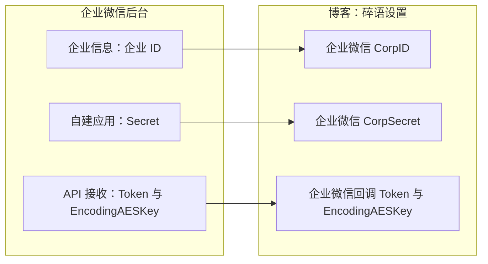
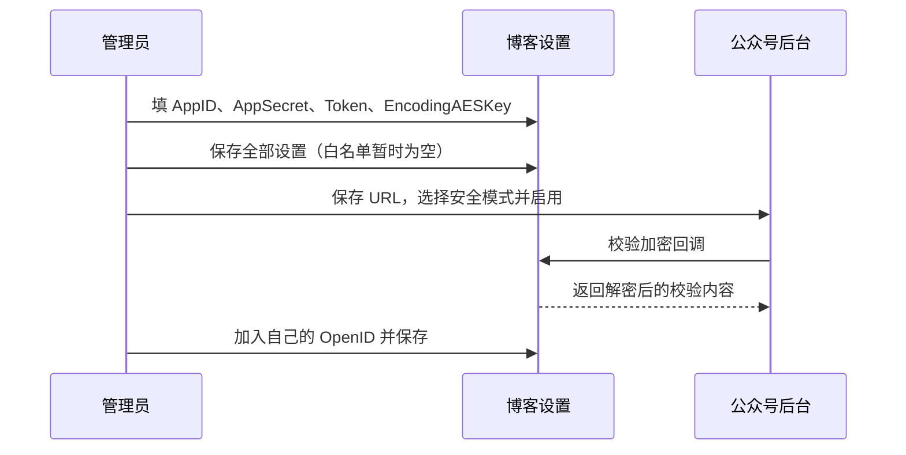
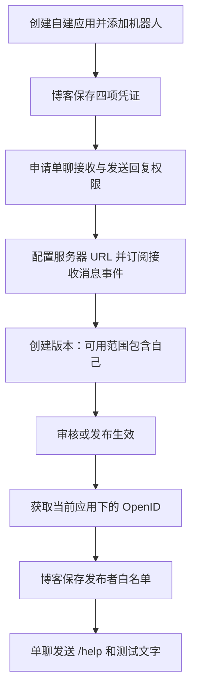

# Firekylin Say

一个适用于 Firekylin 的轻量微博/碎语插件。

## 功能

- 文本、图片、图文、语音、位置、链接和音乐七种内容类型
- 公开、私密、隐藏三种状态
- 从正文中的 `#标签` 自动提取标签，也可以手动填写
- 后台发布、关键词搜索、分页查看、单条编辑、复制，以及基于复选框的批量状态、合并和删除操作
- 合并文本与图片、图文与图片、多张图片、文本与位置、文本与语音
- `/says` 独立公开页面和 `/says/tag/:tag` 标签页，支持分页、音乐卡片和位置地图
- `/api/plugins/say/list` 公开 JSON API
- `say.list` Eta 模板函数和 `Widget_Plugin_Say` 主题 Widget
- 使用 API Key 的外部发布接口，可供浏览器扩展、快捷指令或机器人调用
- 外部接口支持 base64 图片与语音，统一交给 Firekylin 当前配置的上传服务
- 自动识别网易云音乐歌曲地址并读取标题、作者和封面
- 企业微信加密回调，支持文本、图片、语音、位置、链接、表情替换以及 `/help`、`/merge` 命令
- 微信公众号安全模式回调，支持文本、图片、语音、位置、链接、OpenID 白名单以及 `/help`、`/merge` 命令
- 飞书加密事件订阅，支持文本、图片、音频、位置、链接识别和 OpenID 白名单
- QQ 官方机器人 WebSocket 私聊发布，支持文本、图片、图文、可识别语音、链接、发布者白名单和结果回复

碎语保存在 Firekylin 的 `post` 表中，使用独立的 `type=3`，不会出现在文章、页面或附件列表里。

## 安装

```sh
pnpm add firekylin-plugin-say
```

重启 Firekylin 后，在后台打开 **微博列表** 管理内容；在 **插件管理 → 已安装插件 → Say → 设置** 配置发布渠道。首次使用请阅读下方[发布渠道配置教程](#发布渠道配置教程)。仅使用外部 API 发布时才需要设置外部发布 API Key。

## 后台设置

侧栏保留独立的 **微博列表** 入口，不挂入“文章管理”子菜单。设置页通过插件列表中的 **设置** 入口打开，不在微博菜单中单独展示。原有管理、发布和编辑页面地址保持不变。

设置页通过一个表单请求加载全部设置，基础设置及外部 API、企业微信、微信公众号、飞书和 QQ 的字段同时展示。五种发布方式可以同时配置和使用，彼此不互斥；按需填写所需方式即可，无需全部配置。

修改不同发布方式的字段后，点击“保存全部设置”统一保存。所有字段始终保留在同一表单中，无需来回切换，不会因隐藏或卸载字段而丢失尚未保存的编辑。保存后会重新加载最新设置。

## 通用身份查询命令

企业微信、微信公众号、飞书和 QQ 均支持发送纯文本 `/whoami`，返回当前平台中**发送者自己**的身份标识：企业微信返回 UserID，其余返回各自应用/公众号/机器人下的 OpenID。不是博客作者 ID，也不能跨平台通用。

此命令不发布或合并碎语、不上传附件，也不查询其他用户。公众号、飞书和 QQ 未加入发布白名单时仍可查询自己的标识，再交给站点管理员配置授权；普通内容仍按原有权限规则处理。企业微信沿用企业应用可见范围，没有新增发布白名单。所有请求仍先经过渠道认证：微信系加密回调、飞书签名/Token/应用校验、QQ 已认证连接。渠道配置不完整或全局发布已关闭时不能查询。优先使用私聊，避免在群内展示自己的标识。

`/whoami 用户名` 不支持查询他人；外部 JSON API/后台编辑器没有聊天平台发送者身份，正文不会被当作此命令执行。

## 外部发布

```sh
curl -X POST https://example.com/api/plugins/say/publish \
  -H 'Content-Type: application/json' \
  -H 'X-Say-API-Key: replace-with-your-key' \
  -d '{"kind":"text","status":"public","text":"从 API 发布 #Firekylin"}'
```

图片和语音既可以使用已经托管的 HTTPS URL，也可以传入 base64 数据。例如：

```json
{
  "kind": "image",
  "imageBase64": "data:image/jpeg;base64,...",
  "text": "带图片的碎语"
}
```

base64 媒体最大 20 MB，保存位置和服务由 Firekylin 的上传设置决定。插件不提供单独的存储路径配置。

## 发布渠道配置教程

本教程面向第一次配置的用户。只需选择自己使用的渠道，无需把所有渠道都开通。
下面的 `https://blog.example.com` 必须替换成自己的博客地址；名称、ID、回复编号都是示例，不能直接当作配置值。
平台菜单可能随账号类型和后台版本变化，以“接收消息”“服务器配置”“事件与回调”等功能名称定位。
图示为配置关系示意，不是真实控制台截图。

- [开始前准备](#开始前准备)
- [企业微信：创建应用并发布](#企业微信创建应用并发布)
- [微信公众号：配置安全模式与发布者](#微信公众号配置安全模式与发布者)
- [飞书：创建机器人并发布](#飞书创建机器人并发布)
- [QQ：创建官方机器人并发布](#qq创建官方机器人并发布)
- [实际发布与合并示例](#实际发布与合并示例)
- [常见问题排查](#常见问题排查)

### 开始前准备

1. 安装并启用 Say 插件，重启 Firekylin，确认后台能打开 **插件管理 → 已安装插件 → Say → 设置**。
2. 开启 **启用公开列表和消息发布**，填写 **发布作者 ID**：这是博客用户的数字 ID，不是微信、飞书或 QQ 的用户 ID。可在博客用户管理中确认；不清楚时请站点管理员帮助查询，不要直接猜 `1`。
3. 点击 **保存全部设置**。三种聊天渠道收到可发布消息后都会立即创建**公开碎语**，没有预览确认。只想保存私密内容时，请从博客后台选择私密状态发布。
4. 确认博客 HTTPS 地址可从公网访问，回调路径不能被登录页、验证码或访问保护拦截。打开 `/says` 可检查公开页面；直接在浏览器访问回调 URL 缺少平台签名，报错不等于配置失败。
5. 准备图片、语音发布时，先在博客后台上传一张图片，确认存储服务工作正常。新版媒体能力还需要插件的 `media:write` 权限，以及可用且有上传权限的发布作者。
6. 打开两个浏览器标签页：一个是平台管理后台，一个是 Firekylin 设置。Secret、Token、加密密钥只填写到对应后台，不贴进文章、截图或代码仓库。

**关键顺序：先在博客保存参数，再在平台保存回调 URL。** 平台保存时会立即验证博客。
“外部发布 API Key”只用于 `/publish` 接口，不需要填到以下三种渠道的 Token 字段。密码字段留空会保留旧值，不代表清空密钥。


### 企业微信：创建应用并发布

#### 1. 注册或加入企业，创建自建应用

打开 [企业微信管理后台](https://work.weixin.qq.com/)，使用企业管理员账号登录。没有企业时按官方注册流程创建并完成账号要求的验证；已有企业但无管理权限时，请管理员协助创建应用。

进入 **应用管理 → 自建 → 创建应用**，名称可填写“博客碎语”，按要求添加图标和简介。**可见范围先只选自己**，然后创建。

这里需要的是企业自建应用，不是群聊中的 Webhook 机器人。当前插件没有企业微信发布者白名单；能够向这个应用发送消息的人可能以配置的博客作者身份发布或执行合并，因此不要随意开放给全公司。

#### 2. 获取 CorpID 与 CorpSecret

| 在哪里找 | 复制什么 | 填入博客哪个字段 |
| --- | --- | --- |
| 我的企业 → 企业信息 | 企业 ID | 企业微信 CorpID |
| 应用管理 → 刚创建的“博客碎语” → Secret | 当前应用的 Secret；按页面要求由管理员查看 | 企业微信 CorpSecret |

应用详情里的 `AgentId` 当前不需要填写。不要使用通讯录 Secret、其他应用 Secret 或公众号 AppSecret。
CorpSecret 用于下载图片和语音；建议现在一并配置，避免文字能发而附件不能发。

#### 3. 生成 Token 和 EncodingAESKey

在“博客碎语”应用中找到 **接收消息 → 设置 API 接收**。

1. URL 填 `https://blog.example.com/api/plugins/say/wecom`。
2. 点击 Token 旁的随机生成按钮（或按页面规则自行设置）。
3. 点击 EncodingAESKey 的随机生成按钮，获得 43 位密钥。
4. 保持页面打开，先不要提交。将两项分别复制到博客的 **企业微信回调 Token**、**企业微信 EncodingAESKey**。
5. 同时填好上一步的 CorpID、CorpSecret，点击博客的 **保存全部设置**。
6. 返回企业微信，确认两边参数完全相同，再保存 API 接收配置。若有接收事件类型选项，启用用户发送的普通消息。



#### 4. 配置企业可信 IP（媒体下载）

在应用的开发者接口区域查找 **企业可信 IP**，按企业微信要求填写博客服务器访问企业微信接口时使用的公网出口 IP。它不是手机 IP，也不一定是博客域名解析到的 CDN IP。让部署博客的人确认出口地址。

如果平台要求域名主体校验、可信域名或其他账号审核，按该账号页面的要求完成；不要把“可信域名”与“企业可信 IP”当成同一个配置。出口 IP 不固定的部署需先解决固定出口或平台允许的网络方案，不能随便填一个地址。

#### 5. 从手机发送第一条碎语

打开企业微信，切换到对应企业，在 **工作台 → 博客碎语** 中进入应用消息会话；如果先展示应用详情或主页，寻找“发消息”入口。

先发送 `/help`，收到帮助后，再发送 `企业微信发布测试 #日常`。正常会回复 `✅ 发布成功，碎语 #123。`，打开 `https://blog.example.com/says` 核对内容。

**完成标志：** 回调验证通过、本人能进入应用会话、文字出现在博客；需要媒体时再单独测试图片和语音。

官方参考：[接收消息与事件](https://developer.work.weixin.qq.com/document/path/90243)。

### 微信公众号：配置安全模式与发布者

#### 1. 准备有开发配置权限的公众号

打开 [微信公众平台](https://mp.weixin.qq.com/)，注册或登录公众号。使用有开发管理权限的账号，在 **设置与开发 → 基本配置**（部分界面称开发配置）查找 AppID、AppSecret 和服务器配置。

账号类型、认证状态影响可用接口：先在后台接口权限列表确认能接收普通消息；要发语音，还需具备获取访问凭证和临时素材的能力。这里不承诺所有未认证账号都有相同权限，认证与审核按平台要求完成。

当前插件要求**安全模式的加密回调**。仅提供明文 URL/Token 校验的测试号页面不能直接按本教程接入；不要为通过验证改成明文模式。

#### 2. 获取身份参数，准备加密参数

| 公众号后台参数 | 博客字段 | 说明 |
| --- | --- | --- |
| 开发者 ID（AppID） | 公众号 AppID | 使用本公众号的 ID |
| 开发者密码（AppSecret） | 公众号 AppSecret | 按管理员验证流程查看或生成；重置会影响现有接入 |
| 服务器配置中的 Token | 公众号回调 Token | 按平台规则自行设置，两边必须相同 |
| 服务器配置中的 EncodingAESKey | 公众号 EncodingAESKey | 使用随机生成的 43 位密钥 |

公众号已有其他服务接管服务器配置时，修改 URL 会改变消息接收方，先确认是否要切换给 Say；本教程不会自动转发给原服务。

#### 3. 保存博客设置，再启用安全模式回调

1. 在公众号服务器配置中，URL 填 `https://blog.example.com/api/plugins/say/wechat`。
2. 准备 Token、EncodingAESKey，消息加解密方式选 **安全模式**。
3. 暂时不要提交，将上述四项填入博客。**公众号允许发布的 OpenID** 暂时留空，先保存全部设置。白名单为空时所有人都不能发布。
4. 回到公众号后台，提交并启用服务器配置，完成平台验证。确认状态为已启用。
5. 如果获取访问凭证要求 IP 白名单，在公众号基本配置中添加博客服务器的公网出口 IP。不要填手机 IP 或 CDN IP；动态出口需先解决网络配置。



#### 4. 获取自己的 OpenID 并加入白名单

OpenID 是微信用户在**这个公众号下**的身份，不是微信号、昵称、手机号，也不是企业微信用户 ID。

1. 用准备发布内容的个人微信关注该公众号。
2. 向公众号发送 `/whoami`，机器人会返回你在当前公众号下的 OpenID；即使尚未加入发布白名单也可以查询自己的标识。
3. 复制回复中的 OpenID，填入博客 **公众号允许发布的 OpenID**，保存全部设置。多个人每行一个，或用英文逗号分隔。
4. 再次发送 `/help`，现在应收到帮助。再发一条测试文字确认发布成功。

收不到身份回复时，先检查回调配置；也可由管理员通过该公众号有权使用的用户管理接口获取对应用户的 OpenID；不要使用其他公众号获取的 ID。

**完成标志：** 服务器配置已启用且为安全模式，白名单中的本人能发布，未授权用户不能发布。

官方参考：[接入概述](https://developers.weixin.qq.com/doc/offiaccount/Basic_Information/Access_Overview.html)。

### 飞书：创建机器人并发布

#### 1. 创建企业自建应用并添加机器人

打开 [飞书开发者后台](https://open.feishu.cn/app)，登录对应组织，创建**企业自建应用**，名称可填“博客碎语”。没有创建权限时，请组织管理员授权或代为创建。

进入应用，在 **添加应用能力** 中添加 **机器人**。使用应用机器人，而不是群内只有 Webhook 地址的自定义机器人；后者不能完成本教程的收消息和回复流程。

#### 2. 取得四个参数并先保存到博客

| 飞书后台位置 | 参数 | 博客字段 |
| --- | --- | --- |
| 凭证与基础信息 | App ID | 飞书 App ID |
| 凭证与基础信息 | App Secret | 飞书 App Secret |
| 事件与回调 → 加密策略 | Verification Token | 飞书 Verification Token |
| 事件与回调 → 加密策略 | Encrypt Key（没有时按页面操作生成） | 飞书 Encrypt Key |

当前插件要求 Encrypt Key，不能留空。Verification Token 也不是企业微信的 Token 或外部发布 API Key。
先填好这四项并在博客保存。发布者白名单可暂时留空，此时不会发布任何人的消息。

#### 3. 申请消息权限

进入 **权限管理**，选择应用身份权限，按用途开通：

| 用途 | 要查找的权限或接口 |
| --- | --- |
| 接收本人单聊消息 | `im:message.p2p_msg:readonly` |
| 回复发布结果 | `im:message:send_as_bot` |
| 接收群聊中 @ 机器人的消息（可选） | `im:message.group_at_msg:readonly` |
| 下载图片、语音（按需） | 在“获取消息中的资源文件”接口页面查看应用身份所需权限，并按当前控制台提示申请；不要把只接收消息当成已具备下载权限 |

平台可能列出多项可替代权限；按对应接口要求选择，不要为了省事一次申请所有权限。
媒体下载使用消息资源接口，不是简单把消息里的图片地址当作公开 URL。

#### 4. 配置事件订阅

在 **事件与回调 → 事件配置** 中：

1. 订阅方式选择 **将事件发送至开发者服务器**，不用长连接方式，插件没有建立长连接。
2. 请求地址填 `https://blog.example.com/api/plugins/say/feishu`。
3. 确认博客已保存同一应用的四项参数，再保存地址，等待验证通过。
4. 添加 **接收消息 v2.0** 事件 `im.message.receive_v1`，按照页面提示补齐所需权限。

#### 5. 发布应用版本并设置可用范围

打开 **版本管理与发布 → 创建版本**，填写版本号和说明，将可用范围先设为自己或测试成员，再提交发布。组织需要管理员审核时，等审核通过且应用可用后再测试。后续修改权限、事件或机器人能力后，也要按平台要求发布新版本。



#### 6. 获取 OpenID，加入博客发布白名单

飞书 OpenID 以 `ou_` 开头，必须属于**当前应用**。测试应用和正式应用的 OpenID 不要混用。

优先与机器人单聊发送 `/whoami`，直接获取当前发送者的 OpenID，不要求已加入发布白名单；需先完成事件配置和机器人回复权限。也可使用以下方式：

- **API 调试台：** 选择当前应用，打开带 `user_id_type` 的用户接口，选择 `open_id`。如果页面提供成员选择器，选择本人并复制 OpenID；若需实际调用查询接口，先按该接口要求获得权限与用户数据范围。也可使用“通过手机号或邮箱获取用户 ID”，查询类型设为 `open_id`，仅查询本人或已获授权的用户。
- **事件记录：** 应用发布后给机器人发一条消息；如果开发者后台提供事件投递详情，打开 `im.message.receive_v1` 的解码数据，查找 `event.sender.sender_id.open_id`。如果界面只有加密请求或不显示正文，改用 API 调试台，不要把密钥提交给在线解密网站。

将获取的值填入 **飞书允许发布的 OpenID**，每行一个，保存全部设置。
**不要依赖博客的 `rejected Feishu publisher OpenID` 日志取得 ID：当前回调会在进入该日志代码前拒绝非白名单用户，可能没有这条日志。**

#### 7. 单聊测试，再按需测试群聊

在飞书客户端搜索应用机器人，打开单聊，发送 `/help`，再发送 `飞书发布测试 #日常`。成功回复应包含碎语 ID，博客 `/says` 可看到对应内容。

需要群聊时，先开通群 @ 权限并发布版本，再把机器人加入群聊，由白名单内的用户 @ 机器人发送消息。第一次建议使用单聊，便于区分可用范围、群权限和白名单问题。

**完成标志：** 回调验证通过、应用版本已生效、本人在可用范围和博客白名单内、文字发布且收到结果回复。再分别验证图片和语音。

官方参考：[消息常见问题（含控制台截图）](https://open.feishu.cn/document/uAjLw4CM/ukTMukTMukTM/reference/im-v1/guide/faq)、[接收消息事件](https://open.feishu.cn/document/server-docs/im-v1/message/events/receive)、[获取消息中的资源文件](https://open.feishu.cn/document/server-docs/im-v1/message/get-2)、[回复消息](https://open.feishu.cn/document/server-docs/im-v1/message/reply)。

### 实际发布与合并示例

下面是会话效果示意，不是真实账号截图。三种渠道使用相同的帮助和结果文案：

```text
你：/help
应用：发送文本、图片、语音、位置或链接即可发布碎语；/merge ID1,ID2 合并碎语。

你：周末散步，天气很好。 #生活
应用：✅ 发布成功，碎语 #123。

你：[发送一张照片]
应用：✅ 发布成功，碎语 #124。

你：/merge 123,124
应用：✅ 已合并为碎语 #123。
```

编号必须换成实际回复的 ID，使用英文逗号。合并保留最早记录的 ID，支持文字与图片、多张图片、图文与图片、文字与位置、文字与语音等组合。分别发送后、合并前，两条内容已经公开；要整理好再公开，请使用博客后台。

| 内容 | 怎么发送 | 注意 |
| --- | --- | --- |
| 文字与标签 | 直接发文字，加入 `#日常` | `/help` 是命令，不会发布成碎语 |
| 图片 | 发送普通图片消息 | 先测试单张；需要媒体下载与博客上传均可用 |
| 语音 | 发送语音消息 | 保留原始格式，不转码；AMR 不一定能在浏览器播放 |
| 位置 | 使用客户端的位置功能发送位置 | 客户端必须产生插件支持的位置消息，自动位置事件不是同一回事 |
| 普通链接 | 飞书可直接发单独一条 URL；微信渠道使用链接消息卡片 | 微信渠道粘贴普通 URL 作为文字发送时，通常保存为文字 |
| 网易云音乐 | 发送包含歌曲 URL 的文字 | 插件尝试读取歌曲信息，上游不可用时可能失败 |
| 视频、普通文件、复杂富文本卡片 | 当前不作为支持的发布方式 | 改用支持的文字、图片或语音消息 |

每次测试按 **帮助 → 文字 → 图片 → 语音 → 合并** 逐步进行。没收到回复时先查看后台碎语列表，不要立即连续重发。

### 常见问题排查

| 现象 | 检查顺序 |
| --- | --- |
| 回调地址保存失败 | 博客设置是否先保存并启用 → URL 路径 → 公网 HTTPS/证书 → 是否有访问保护 → 两边 ID、Token、加密密钥是否一致 |
| 企业微信工作台看不到应用 | 是否切换到正确企业、可见范围是否包含本人 |
| 公众号验证失败 | 是否安全模式、是否使用同一公众号 AppID、是否已启用服务器配置；明文测试号不是此入口 |
| 公众号提示没有发布权限 | 关注并发消息 → 查拒绝日志 → 将本公众号下的本人 OpenID 加入白名单 |
| 飞书没有输入框或收不到消息 | 机器人能力、单聊接收权限、接收消息事件、版本发布及可用范围；见官方消息 FAQ |
| 飞书没有回复也没有碎语 | 先查事件是否投递，再检查当前应用 OpenID 是否加入博客白名单 |
| 已有碎语但没有飞书回复 | App Secret、发消息权限、会话发言权限和服务日志；不要重复发布已有内容 |
| 文字成功、图片或语音失败 | 平台媒体读取权限/Secret/出口 IP → 博客上传服务 → 发布作者与插件媒体权限 |
| 提示文件已上传但媒体登记失败 | 核对后台媒体记录和存储文件，根据参考编号查日志，不直接重发 |
| 语音已发布但无法播放 | 检查原始格式和浏览器支持，插件不会自动转成 MP3 |
| 多次收到相同碎语 | 平台重试、手动重发或服务重启可能导致重复；本插件没有跨实例持久化去重 |

提交问题时提供渠道、失败步骤、发生时间、参考编号和脱敏后的错误码即可。不要附 Secret、Token、加密密钥或完整原始回调内容。


## 发布反馈与媒体兼容性

### 飞书发布结果反馈

碎语保存成功后，机器人回复原消息“发布成功，碎语 #ID”；合并成功也会回复对应 ID。已验证且在白名单内的用户，在保存、附件下载或上传等步骤失败时，会收到失败阶段、排查建议和参考编号。回复不会直接暴露异常堆栈、数据库连接信息、密钥或第三方接口的原始报错内容。可根据参考编号查询服务日志。对于可能已经部分完成的操作，请先核对后台再重新发送，避免重复发布。

请填写飞书 App Secret，并为应用开通 **以应用的身份发消息（`im:message:send_as_bot`）** 权限，使权限生效。机器人需要有对应会话的发言权限，单聊用户也需在机器人可用范围内。只配置事件订阅和消息读取权限并不能保证回复成功。

发布和回复是两个独立结果：回复接口故障不会把已保存的碎语当作发布失败，也不会在当前进程收到重复事件时再次创建碎语。重送事件可重试尚未成功的回复；回复使用稳定 `uuid`，飞书在 1 小时内对相同 `uuid` 去重。若回复本身无法发送（如权限不足），只能在服务日志中查看问题，不能依赖同一个失败接口再次发错误提示。

**可靠性边界：** 当前事件结果和并发去重仍是进程内缓存，仅保留最近 1000 条，跨实例、重启或缓存淘汰后不能保证去重。本次没有引入持久化队列或跨实例锁。处理和回复均在当前请求内等待完成，不使用响应后裸 Promise；慢附件、网络请求和冷启动仍可能超过飞书 3 秒的回调时限。回复失败不会主动调度后台重试，不保证最终送达。后续要提供更强保证，需要持久化事件/回复状态与任务调度。

### 上传与媒体管理兼容性

新版核心提供 `ctx.media.upload` 时，API、企业微信、微信公众号、飞书和 QQ 的图片、语音均使用该入口，
Say 在 `register(ctx)` 绑定媒体能力，以配置的 `authorId` 作为显式所有者，保持 URL 返回值。
正常媒体路径不读取 ThinkJS 模型或全局上传函数；核心读取上传配置并校验插件及作者。
Say 声明 `media:write`，作者必须是启用的管理员、编辑或投稿者。插件负责飞书验签及发送者白名单。
先合入并升级包含此 API 的 Firekylin 核心，再合入/使用本次 Say 更新；不要仅根据核心现有版本号判断支持情况。
没有 `ctx.media` 的旧核心使用独立兼容模块：有过渡版全局上传 API 时复用该 API；否则保持旧上传行为，
并明确记录无法登记媒体、需要升级。能力已存在但拒绝权限、作者或上传请求时，绝不降级重传。
核心停用插件会拒绝新的上传；已开始传输的操作继续完成登记，不等于有持久化异步队列。
因此保留原 engines 范围，不把尚未发布的核心版本写成已满足的依赖。历史文件不补录。

上传成功而登记失败时，底层媒体函数保留 `MEDIA_REGISTRATION_FAILED`、`uploadedUrl` 和 `retryable: false`。
飞书回复会明确提示“文件已上传，但媒体登记失败”，要求先核对后台媒体记录和存储文件，勿直接重发。
服务日志仅记录安全错误码和参考编号，不输出文件 URL、数据库详情或任意异常消息。
不会降级重传，也不会删除已存储文件；数据库写入可能已提交，应先核对媒体记录后再恢复。
这不是跨请求幂等保证：外部平台重发失败事件、手动重发、进程重启或多实例都可能重新上传。

Say 支持 JPEG、PNG、GIF、WebP 图片以及 MP3、AMR/AMR-WB、Ogg 音频，单文件最多 20 MB。
Ogg 封装的 Opus 支持 `audio/opus`、`audio/ogg`、`application/ogg`、`audio/x-ogg` 和通用二进制 MIME；
仍检查内容签名，不能仅凭 `.opus` 后缀接受未知文件。不执行转码，也不保证各浏览器能播放 AMR 或裸 Opus。
核心 `media.upload` Ability 的图片限制不会用于 Say。

飞书使用消息资源下载接口 `messages/{message_id}/resources/{file_key}?type=file` 下载语音。
回归测试覆盖模拟飞书下载到上传登记的链路；尚未使用真实飞书账号、生产存储或原始报错附件验证。
“无法识别的文件类型”并非当前主分支的错误字面量，不能仅据该提示确定生产故障来源；
需结合实际响应 MIME、文件格式和服务端错误阶段确认。MIME 别名修复不代表所有语音格式均已支持。

### 各渠道统一发布反馈

QQ、企业微信、微信公众号、飞书、外部 API 和后台发布使用一致的成功提示（含碎语 ID），合并操作使用一致的合并提示。企业微信和公众号通过加密回调回复，飞书通过消息回复接口发送，API 返回 JSON，后台显示表单提示。

QQ、企业微信、公众号、飞书和外部 API 的处理失败会返回经过脱敏的失败提示与日志参考编号；认证失败仍遵循原有拒绝规则。API 成功响应保留原有碎语字段并新增 `success: true` 和 `message`；处理失败返回 HTTP 400（参数错误）或 500，以及 `success: false` 和 `message`。调用方应检查 HTTP 状态和 `success`。

统一提示不改变各渠道的超时、重试和去重能力；企业微信与公众号仍使用原有同步回调，没有新增持久化去重。


### QQ：创建官方机器人并发布

此入口使用 QQ 官方机器人 API，服务端主动建立 **WebSocket 长连接**，不是登录个人 QQ 账号的非官方协议。首版仅接收 **单聊 `C2C_MESSAGE_CREATE`**，不处理群聊、频道、卡片、引用消息或聊天记录。无需安装 OpenClaw，也不需要创建 QQ Webhook 回调地址。

#### 1. 确认部署条件与平台限制

- Firekylin 必须运行在 **单实例、单工作进程、持续在线** 的 Node.js 22.13+ 环境。支持普通常驻进程和 ThinkJS `workers: 1` 模式。不要同时启动多个连接同一机器人的博客实例。
- 不适用于 Vercel、AWS Lambda 等按请求运行/冻结的 Serverless。插件会拒绝已识别的这些环境以及多工作进程的 Node cluster；其他多副本部署无法自动检测，请自行保证只有一个工作进程。不要只伪造环境变量绕过检查。
- 不用为 QQ 接收消息开放入站端口，也不用为这个连接配置备案回调域名；博客本身的域名、托管要求是另一回事。服务器需能访问 QQ HTTPS API 和 WSS 网关。
- **不承诺免 IP 白名单。** 官方接入说明要求正式环境新机器人配置出口 IP 白名单；沙箱规则与快速创建入口的可用权限可能不同，以当前账号控制台和实际连接结果为准。白名单填写服务器访问 QQ 的公网出口 IP，不能填手机 IP、内网 IP 或 CDN 的入站 IP。动态出口环境需要先解决出口问题。
- 沙箱测试名单、机器人上线/使用范围、博客发布者白名单是不同的配置：能与机器人聊天并不自动获得博客发布权。
- 文档不承诺任意个人账号都拥有群聊或公开上线权限。本插件只需要自己的单聊测试/使用权限。

#### 2. 创建机器人，获取 AppID 和 AppSecret

1. 打开 [QQ 开放平台](https://q.qq.com/)，按页面指引注册/登录并绑定 QQ。
2. 可以使用平台提供的 [机器人快速创建入口](https://q.qq.com/qqbot/openclaw/index.html)，或在控制台创建机器人。快速入口虽然面向 Agent，Say 直接使用它提供的官方机器人凭据，不依赖 Agent 软件。
3. 进入机器人管理/开发设置，复制 **AppID** 和 **AppSecret**。机器人名字、数字 QQ 号、旧版 Token 都不能代替这两个值。
4. AppSecret 只填在博客后台，不要放进文档、截图、公开日志或聊天。遗失或泄露时在 QQ 平台重置，并更新博客设置。
5. 在平台选择 WebSocket 接收方式（若提供选项）；无需填写 `/api/plugins/say/qq`，插件没有这个 HTTP 回调路由。

平台菜单名称可能调整，可参照 [官方启动接入](https://bot.q.qq.com/wiki/develop/api-v2/dev-prepare/getting-started.html) 和 [事件订阅说明](https://bot.q.qq.com/wiki/develop/api-v2/dev-prepare/interface-framework/event-emit.html)。旧教程中的 WebSocket 停用说法不应直接套用到当前接入方式；本实现依据当前官方 WebSocket 文档。

#### 3. 配置测试范围及网络

1. 如果是普通开发中的机器人，在 QQ 控制台打开 **沙箱配置 → 消息列表/单聊配置**，加入自己的 QQ，按平台提供的二维码添加机器人并开始单聊。
2. 如果使用快速创建入口提供的“扫码聊天”，按该页面说明添加机器人。快速创建与传统沙箱不一定使用相同环境；确认该机器人的使用环境。
3. 若控制台要求 IP 白名单，填写部署服务器的公网 **出口** IP。可以让服务器管理员核实；即使博客在 CDN 后面，出站 API 请求也未必经过 CDN。
4. 确认机器人有单聊收消息及回复消息权限。插件订阅 `GROUP_AND_C2C_EVENT`（`1 << 25`），但只处理其中的单聊事件。
5. 只有需要扩大使用范围或正式上线时，才按 QQ 平台完成对应审核。本插件不会替你提交审核或绕过平台限制。

#### 4. 填写博客后台 QQ 设置

打开 **插件管理 → 已安装插件 → Say → 设置**，保持“启用公开列表和消息发布”开启，核对“发布作者 ID”，填写：

| 字段 | 填写方式 |
| --- | --- |
| 启用 QQ 私聊发布 | 开启后连接机器人；默认关闭 |
| QQ 沙箱环境 | 默认开启，使用传统沙箱 API；机器人使用正式/快速入口环境时按平台实际要求关闭 |
| QQ 机器人 AppID | QQ 平台提供的 AppID |
| QQ 机器人 AppSecret | QQ 平台提供的密钥；留空保留原值 |
| QQ 允许发布的 OpenID | 第一次可暂留空，下一步获取自己的 OpenID 后填写 |

点击 **保存全部设置**。正常启动日志包含 `say: QQ WebSocket ready (private messages only).`。保存会触发连接配置刷新；运行中的进程也每 30 秒读取一次配置。更换凭据/环境会重新连接；关闭 QQ 或全局消息发布开关会断开连接。停用插件会清理连接及定时器。

仅“设置已保存”不代表 QQ 认证成功，请以连接日志及下方实际对话验证为准。正式 API 使用 `https://api.bot.qq.com`，传统沙箱使用 `https://sandbox.api.sgroup.qq.com`；不会在失败后自动切换环境。

#### 5. 获取并授权自己的 OpenID

1. 在手机 QQ 与机器人 **单聊**，发送 `/whoami`。
2. 机器人回复当前发送者自己的 OpenID。此命令允许尚未加入博客白名单的用户调用，但不会创建碎语，也不会返回其他人的标识。
3. 将返回值完整复制到博客后台 **QQ 允许发布的 OpenID**，每行一个，然后保存全部设置。
4. OpenID 不是数字 QQ 号，并且通常绑定当前机器人；更换机器人后需重新获取。白名单为空时所有用户均不能发布。
5. 只添加可信的站点发布者。他们可以公开发布，并通过 `/merge` 合并已有碎语；这不是仅能聊天的访客名单。

#### 6. 按顺序验证发布

1. 发送 `/help`，确认收到本渠道的帮助信息。
2. 发送 `QQ 发布测试 #日常`。机器人应在保存完成后回复 `发布成功，碎语 #ID`；在后台列表及 `/says` 核对作者、正文和标签。**QQ 发布默认公开。**
3. 单独发一张 JPEG/PNG/GIF/WebP 图片，再试文字附带图片。单条最多 10 张，每个文件不超过 20 MB。图片经过现有媒体上传入口保存并登记，不长期引用 QQ 临时下载地址。
4. 发一段语音。若 QQ 提供 `voice_wav_url`，下载平台转换后的 WAV，并检查 PCM/float WAVE 结构；没有转换地址时，仅接受原有可识别的 MP3、AMR、AMR-WB、Ogg 音频。**不直接支持 SILK，不在服务器调用转码程序**，也不使用 ASR 文本替代原始语音。实际能否播放还取决于浏览器和编码。
5. 单独发送完整 `https://...` URL 可保存为链接；复杂音乐卡片、位置卡片、引用/转发聊天、视频和普通文件暂不支持。
6. 发送 `/merge ID1,ID2` 可以复用已有合并规则。合并前各条碎语已经公开；需要先整理再公开时请使用后台。
7. 从另一个未授权账号发送正文，应不会发布。撤销自己的白名单或关闭 QQ 后，确认新消息不再写入。

结果回复只含结果和碎语 ID，不回传博客链接，避免为基础发布额外依赖消息中的 URL 放行配置。

#### 7. 排查连接、发布与回复

| 现象 | 检查事项 |
| --- | --- |
| 没有 ready 日志 | 全局开关、QQ 开关、AppID/Secret、部署是否常驻单进程、出站 HTTPS/WSS；日志只输出安全错误码 |
| `QQ_API_FAILED` | 日志中的 QQ 数字错误码/HTTP 状态；核对凭据、平台使用权限、沙箱选择、出口 IP 白名单 |
| “该机器人去火星了”或不能进入单聊 | 机器人状态、测试人员/使用范围、添加机器人流程；同时检查服务连接状态 |
| `/whoami` 没回复 | 先确认是机器人单聊且服务 ready，再检查平台单聊与回复权限及选择的环境 |
| `/whoami` 成功但正文无反应 | 博客 OpenID 白名单必须是当前机器人的标识，且总发布开关开启 |
| 文字成功、附件失败 | 媒体 URL 是否属于允许的 QQ 媒体域名、附件格式/大小、Firekylin 存储配置、作者与 `media:write` 权限 |
| `MEDIA_TYPE_MISMATCH` / `MEDIA_TYPE_UNSUPPORTED` | QQ 是否返回 SILK 或其他不支持的格式；原生语音是否附带有效 WAV 地址；不要仅修改扩展名重试 |
| 文件已上传但媒体登记失败 | 先核对存储与后台媒体，勿直接重发；插件不会降级重传或删除远端文件 |
| 已保存但未收到回复 | 查看回复阶段日志、QQ 发消息权限、被动回复时效；先核对后台，不要重复发布 |

日志不输出 AppSecret、Token、附件 URL、原始消息、上游异常正文或数据库详情。附件只从 HTTPS QQ 媒体域名（`nt.qq.com`、`nt.qq.com.cn`、`grouppro.qq.com` 及其子域）下载，拒绝重定向，不携带机器人访问凭据；新增 CDN 域名需要审核代码，不能在后台填写任意下载地址。

#### 可靠性及验证范围

连接使用心跳确认、指数退避重连和 Session Resume。发布处理串行化；缓存最近 1000 条事件结果，并根据消息 ID 和平台消息索引区分重送。保存/上传失败也缓存为终态，避免重复执行可能已部分成功的操作；回复失败后，重送事件只重试回复，使用稳定 `msg_id + msg_seq`。没有自动无限重发回复。

这是 **进程内尽力去重**：重启、缓存淘汰、多实例、滚动更新和崩溃窗口不保证恰好一次。没有持久化队列/事件表，平台未重送的消息也不保证最终送达。停用后拒绝新工作，已开始的数据库/存储操作可能完成；多附件失败可能留下已登记媒体但未形成碎语，需先核对后台。

测试使用模拟 QQ 网关/API、真实 Say 媒体校验和注入的核心媒体能力，覆盖授权、图片/WAV、部分失败、重复消息、回复失败、重连及停用。**没有使用真实 QQ 账号、生产存储或真实语音完成端到端验证**，首次接入请按上述步骤自测。

官方参考（核对日期：2026-11-19）：[访问凭证](https://bot.q.qq.com/wiki/develop/api-v2/dev-prepare/access-token.html)、[单聊事件与语音字段](https://bot.q.qq.com/wiki/develop/api-v2/autogen/event/c2c_message_create.html)、[单聊回复](https://bot.q.qq.com/wiki/develop/api-v2/autogen/api/v2_users_user_openid_messages.post.html)、[传统接入/IP 白名单说明](https://github.com/tencent-connect/bot-docs/blob/main/docs/README.md)。平台规则以实际账号及官方更新为准。

## 碎语评论

评论在 Say 插件内实现，无需修改 Firekylin 核心或新增数据库表。每条碎语有独立详情地址 `/says/<数字 ID>`，公开列表中的“详情 / 评论”可以进入该页面。

### 开启与审核

1. 在插件列表中打开 Say 设置，开启「启用碎语评论」并保存。默认关闭，升级不会自动开放历史碎语。
2. 在「微博列表」编辑需要开放评论的碎语，开启「允许评论」。后台新建、外部 API 以及消息渠道发布的碎语默认不开启评论；API 发布可明确传入 `allowComments: true`。全局开关和单条开关必须同时打开。
3. 打开公开碎语的 `/says/ID` 页面提交评论。访客填写昵称；邮箱、网站和字数要求沿用站点评论设置。站点开启强制登录时，先通过博客登录页登录。身份由服务器验证，客户端不能指定评论作者或审核状态。
4. 在 Firekylin 后台「评论管理」中审核。**包括管理员在内的所有新评论都先进入待审核**；命中站点禁用词的评论进入垃圾评论。只有审核通过的评论公开展示。拒绝、转垃圾或删除后，不再公开展示。
5. 关闭任一评论开关会隐藏该条碎语的评论及表单，但保留记录；重新开启后可再次展示。碎语设为私密、隐藏或插件关闭后，详情与评论接口不再公开访问。

正文按纯文本展示，不执行 HTML，也不渲染 Markdown。邮箱、IP、User-Agent、账号 ID 不会出现在公开评论响应中。列表每页 20 条；公开模板仍可用 `say.list` / `Widget_Plugin_Say` 读取 `allowComments`、`commentCount`，并自行链接到 `/says/ID`。

### 验证码和接口

沿用站点「评论」区域的 Turnstile / reCAPTCHA v3 配置；使用现有验证码服务验证，不需要另配一套密钥。验证码脚本需要浏览器能访问对应服务；reCAPTCHA v3 使用 `social` action。已登录身份沿用核心的验证码豁免规则。禁用 IP、必填信息与字数限制也会校验。

- `GET /api/plugins/say/comments/ID?page=1`：返回 `{success:true,data:{page,pageSize,total,items}}`；每项仅包含 `id`、`nick`、`comment`、`createdAt`。
- `POST /api/plugins/say/comments/ID`：同源 JSON 请求，字段为 `comment`、`nick`、`mail`、`link`、`captcha`。需要准确的本站 `Origin` 请求头；浏览器表单自动提供。跨站发布 API Key 不能绕过评论身份或审核。成功仅表示已入库等待审核。
- 写入有重复评论检查、IP 冷却（至少 10 秒，默认 60 秒，沿用站点 `ipQps`），以及同进程同 IP 在途提交锁。多实例之间不提供严格的全局并发锁；仍需入口层限流防止滥用。网络失败后不要自动重试，先核实提交情况。

### 首版边界与兼容性

- 使用现有 `post.allow_comment`、`post.comment_num` 与 `comment.post_id`，不改文章类型，不接管 `/api/comment`。依赖当前 Firekylin 的内部 `comment` 身份/输入校验服务和 `captcha` 服务；缺少接口时评论提交会安全失败，不会退回无验证写入。保持插件现有核心版本要求，启用前建议在测试站验证安装版本。
- 使用后台已有的审核、编辑和删除能力。当前核心后台会把 type-3 碎语的「原文」链接按文章生成，这个链接可能 404；请从微博列表或 `/says/ID` 查看。该 PR 不修改核心以修正这个链接。
- 首版提供平铺评论，**不支持楼中楼或后台「回复」按钮**（核心回复入口仍按文章/页面解析）。不提供访客自助编辑、删除或插件内登录/OAuth 界面；登录复用博客现有会话。
- 插件直接保存待审核评论，不调用核心文章评论创建流程，因此不触发其创建事件、AI 自动审核或新评论邮件通知。后台审核仍走核心原有审核流程。不要依赖文章评论的创建钩子处理碎语评论。
- 有任何关联评论（包括待审核、垃圾评论）的碎语禁止合并、删除，避免评论失去归属。可以先设为私密，或在评论管理中删除关联评论后再操作；复制碎语不会复制评论。评论开关不会清理历史数据。
- 尚未进行真实站点、真实验证码服务和浏览器完整端到端验证。仓库测试覆盖插件提交/公开隔离/输入校验/表单转义，设置 `FIREKYLIN_CORE_PATH=/path/to/firekylin` 可额外验证真实核心服务的登录身份、审核及数据互通：

  ```sh
  FIREKYLIN_CORE_PATH=/path/to/firekylin node --test packages/say/test/comments.test.js
  ```
